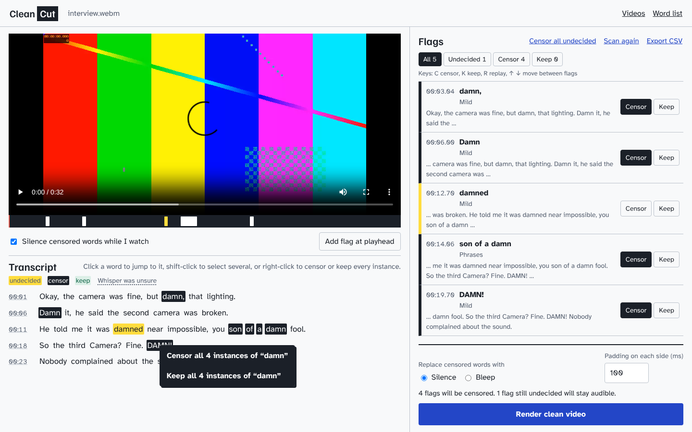

# Clean Cut

Clean Cut transcribes a video, flags words from your list with timestamps, and lets you review each flag. It then renders a copy with those words silenced or bleeped. Everything runs on your computer after the speech model downloads.



It uses [faster-whisper](https://github.com/SYSTRAN/faster-whisper) for transcription with word-level timestamps, and [FFmpeg](https://ffmpeg.org) for editing the audio. The video picture is copied without re-encoding.

## Set up

You need Python 3.10 or later and FFmpeg. On Windows, you also need a current Microsoft Visual C++ Redistributable. Older versions crash the speech engine as it starts.

### Windows

1. Install [Python](https://www.python.org/downloads/) and FFmpeg (`winget install ffmpeg`), then open a new PowerShell window.
2. Install or update the [Visual C++ Redistributable](https://aka.ms/vc14/vc_redist.x64.exe), version 14.40 or later. You can also run `winget install -e --id Microsoft.VCRedist.2015+.x64`.
3. In the Clean Cut folder, run:

   ```powershell
   python -m venv .venv
   .venv\Scripts\python -m pip install -r requirements.txt
   .venv\Scripts\python app.py
   ```

### Mac and Linux

Install FFmpeg with `brew install ffmpeg` or `sudo apt install ffmpeg`. Then, in the Clean Cut folder, run:

```bash
python3 -m venv .venv
.venv/bin/python -m pip install -r requirements.txt
.venv/bin/python app.py
```

### Open the app

Go to http://127.0.0.1:5057. The first video downloads the speech model, which can take a few minutes. Later videos reuse it. To start Clean Cut again later, run only the last command.

To update, replace the app's files with the new version but keep the `data` folder, which holds your videos and decisions.

## Use it

1. Upload a video and choose a transcription quality.
2. Select a flag to hear it in context, then choose **Censor** or **Keep**. You can also press C or K.
3. Add anything Whisper missed. Select words in the transcript, or pause the video and choose **Add flag at playhead**.
4. To censor a word everywhere, right-click it in the transcript and choose **Censor all**. You can also click the word and use the button above the transcript. Capitalization and punctuation are ignored, but other forms need their own step, so "damn" won't match "damned". This includes words not on your list and overrides any Keep decisions for that word. Use **Undo** in the message that appears if you change your mind. **Keep all** works the same way in reverse, but a longer flag that contains the word keeps its own decision.
5. Adjust a flag's start and end times if part of a word is still audible.
6. Choose **Silence** or **Bleep**, then render and download the clean video.

Each stage shows its own progress bar and percentage. Loading the speech model shows "In progress" instead because it doesn't report a percentage. Undecided flags stay audible in the render. **Export CSV** saves the timestamped flag list.

## What to check

- **Listen before you publish.** Whisper can miss or mishear words, so an empty flag list doesn't prove the audio is clean. Words with a dotted underline are ones Whisper was unsure about.
- **Check subtitles.** Rendering copies subtitle tracks unchanged, so censored words can still appear in them. Clean Cut warns you when a video has subtitle tracks.
- **Burned-in text isn't changed.** Only the audio is edited.
- **Everything at that moment is censored.** Music and other sounds drop out along with the word.

## If transcription stops

On Windows, the speech engine needs Microsoft Visual C++ Redistributable 14.40 or later. To update it, run `winget install -e --id Microsoft.VCRedist.2015+.x64`.

Long videos are transcribed in 10-minute parts, and each finished part is saved. Clean Cut restarts automatically after a crash and tries safer speech engine settings if needed. If the same part keeps failing, the video's page shows **Try again**, which continues from the saved parts without another upload. If the app itself was closed, open the video from the Videos page. Each stopped video keeps a `worker.log` file in its folder under `data/jobs`.

## Customize it

- **Word list:** edit it on the Word list page. Your copy is stored at `data/wordlist.txt`. To apply changes to a video you already uploaded, choose **Scan again**. Your decisions and hand-added flags are kept.
- **NVIDIA GPU:** set `WHISPER_DEVICE=cuda` and `WHISPER_COMPUTE=float16` before starting the app. This requires NVIDIA's CUDA libraries.
- **Port:** set `PORT` to use something other than 5057.

## Good to know

- Clean Cut stores a copy of each video and render in `data/jobs`. Deleting a video in the app removes those copies, but not your original file.
- The app only accepts connections from your own computer.
- The starter word list includes slurs and other offensive terms so that they can be found. Edit it to suit your audience.

## Development

Install the test dependencies with `python -m pip install -r requirements-dev.txt`, then run `python -m pytest tests`. The tests need FFmpeg, but not the speech model. They run on GitHub Actions for each push.

The app is split into a few files:

- `app.py`: the Flask app, job storage, and progress tracking
- `pipeline.py`: audio extraction, word-list matching, and rendering with FFmpeg
- `transcribe_worker.py`: transcription in a separate process, one 10-minute part at a time
- `static/` and `templates/`: the interface

## License

Clean Cut is released under the [MIT License](LICENSE). The bundled fonts, Atkinson Hyperlegible and Familjen Grotesk, are under the SIL Open Font License 1.1.
